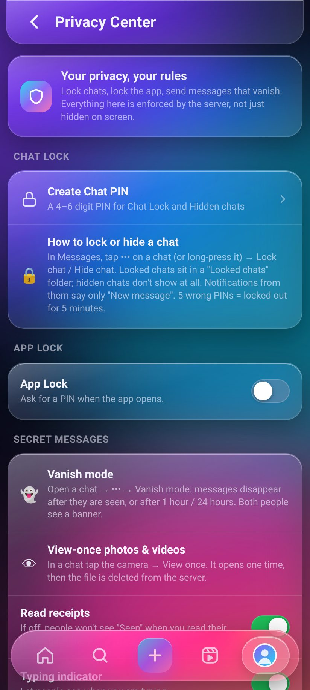
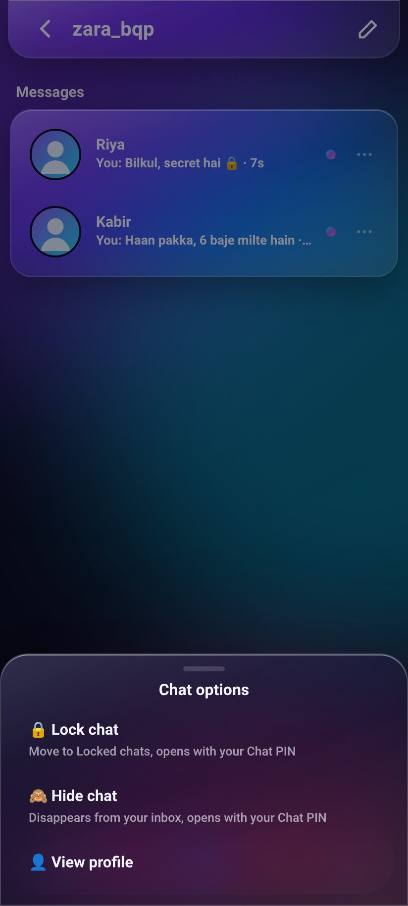
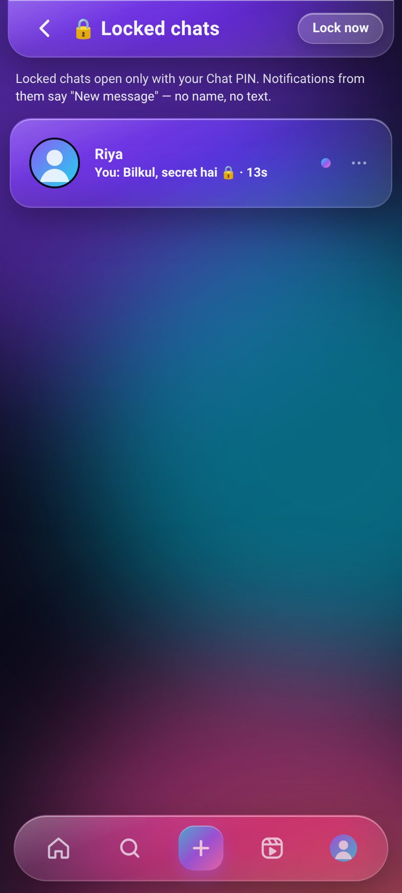
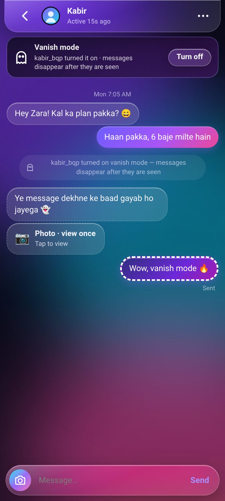
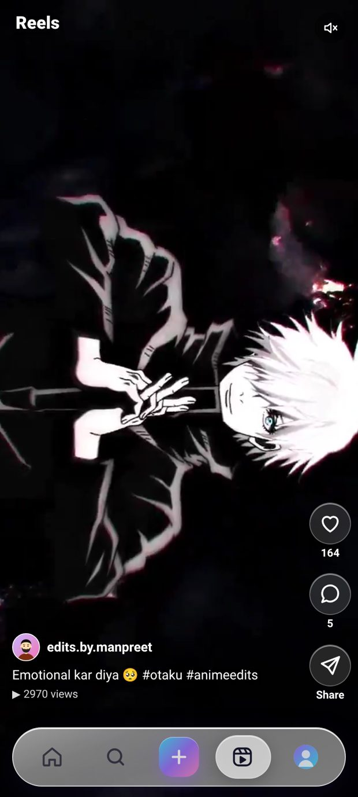

# Private Insta 🔒📸 — Instagram-style clone in Liquid Glass UI (v1.6)

**Live:** https://instaglass-live.sites.tab.bot  ·  test login: `demo` / `demo1234` (or sign up — it takes 5 seconds)
**Download v1.6:** [Android APK](https://github.com/nm621532-byte/instagram-clone-techbroz/releases/download/v1.6/InstaGlass-v1.6.apk) · [Web app ZIP](https://github.com/nm621532-byte/instagram-clone-techbroz/releases/download/v1.6/instaglass-web-v1.6.zip) · [All releases](https://github.com/nm621532-byte/instagram-clone-techbroz/releases)

> ⚠️ **Disclaimer:** Educational project by **Tech Bro Z**, not affiliated with Instagram/Meta. Name, logo and design are original.
> (The repo name stays `instagram-clone-techbroz`; the app was called InstaGlass in v1.0 and is **Private Insta** from v1.1.)

<p>
   
</p>

## 🆕 v1.6 — Home feed fix 🏠 (Hinglish)
Post daalne ke baad apni post sirf ek baar Home ke upar dikhti hai. Refresh karo (Home dobara tap, app dobara kholo) to upar doosron ki nayi posts aati hain; apni post profile pe rehti hai aur feed mein kabhi-kabhi neeche. Followers ko aapki nayi post unke Home pe upar dikhti hai.

## v1.5 — Privacy update 🔒 (Hinglish)
- **Privacy Center** (Settings → Privacy Center): saari privacy settings ek jagah, simple English description ke saath.
- **Chat Lock:** kisi bhi chat pe ••• (ya long-press) → *Lock chat*. Locked chats inbox se hat ke **Locked chats** folder mein chali jaati hain — sirf **Chat PIN** (4–6 digit) se khulti hain. 5 galat PIN = 5 minute lockout. PIN bhool gaye? Account password se naya PIN.
- Locked chat ka notification sirf **"New message"** dikhata hai — na naam, na message.
- **Hidden chats:** chat ko poora chhupa do (inbox mein dikhegi hi nahi), Privacy Center → Hidden chats se PIN daal ke kholo.
- **App Lock:** app kholte hi PIN (har phone/browser pe). Background mein Now / 1 / 5 / 15 / 60 min ke baad khud lock. Android app mein **fingerprint** se bhi khulta hai.
- **Vanish mode:** chat ke ••• → Vanish mode — message dekhne ke baad, ya 1 ghante / 24 ghante baad server se delete. Dono ko banner dikhta hai.
- **View once photo/video:** camera → *View once* — ek hi baar khulega, phir server se file delete.
- App background mein jaate hi chats **blur**; Android app locked/vanish chats aur view-once mein **screenshot block** karta hai (web pe screenshot detect nahi ho sakta).
- **Naya logo "Ghosty" 👻🔒** — app icon, splash screen, website icon sab naya (Noor ne logo 9 choose kiya).
- Naye toggles: **Last seen chhupao**, **Followers/Following list chhupao**, **Screenshot block**. Private account, follow requests, read receipts, restrict, block, Close Friends — sab pehle jaise.

## v1.4 — Naya upload, Classic mode, fresh Reels ✨ (Hinglish)
- **Home ya Reels pe dobara tap** karo → upar scroll + bilkul naya feed (nayi order). Reels tab har baar kholne pe **poori nayi shuffle** — pehli reel bhi alag, neeche wali bhi alag; jo reels dekh li hain woh peeche chali jaati hain, ek session mein koi reel repeat nahi.
- **Home feed pe reel tap** → full-screen Reels usi reel se shuru, swipe karo aur reels aayengi; Back dabao → Home wahi scroll position pe.
- **Classic mode** (Settings → Customise): ek tap mein flat purana Instagram look — no glass, no blur, no glow. Light + dark dono mein, aapke account pe save hota hai. Default abhi bhi Liquid Glass.
- **Naya upload screen** (Post / Reel / Story): upar right mein **Share** button + neeche Save draft / Share bar (bottom nav upload pe chhup jaata hai, ab Share kabhi nahi chhupega).
  - Cover frame chuno, trim, speed 0.5x–2x, 11 filters, rangeen text (drag karke kahin bhi rakho), 6 royalty-free music tracks ya original sound / mute.
  - Caption mein #hashtag aur @mention suggestions, logon ko tag karo, location likho.
  - Like count chhupao, comments band karo, audience: Everyone / Followers / Close Friends.
  - **Draft save** karo aur baad mein kholo; upload pe progress bar.
- Reel ka share sheet (WhatsApp / Facebook / Copy link) ab poora dikhta hai; like/comment/share buttons caption ke upar.

## v1.3 — Anime reels import 🎬 (Hinglish)
Ab app mein **hazaaron anime edit reels** hain! Reels tab (neeche 🎬 icon) kholo, upar-neeche swipe karo.
- Har reel ek alag "anime page" (bot account) ki hai, caption ke saath, 20–800 likes aur kuch comments ke saath; pichle ~30 din mein post hui dikhti hain.
- Home feed, Explore aur Reels sab **pages mein load** hote hain (neeche scroll karo, aur aate jaate hain) — hazaaron reels ke saath bhi fast.
- Video sirf tab chalti hai jab screen pe dikhe (muted autoplay), baaki ruk jaati hain — data aur battery bachta hai. Har reel ka poster (thumbnail) pehle dikhta hai.
- Admin panel mein naya **"Reels import 🎬"** tab: kitni reels import hui, inbox mein kitni baaki, disk, **Auto-import on/off**, "Import next batch", "Delete all imported reels", aur latest reels ki list (Open / Delete).
- Import idempotent hai: wahi file dobara import nahi hoti; delete ki hui reel wapas nahi aati.



## v1.6.4 — 1000M followers, 1M likes 🚀 (Hinglish)

- 👑 Admin ab kisi bhi account ko **1000 million (1B) followers** tak de sakta hai, aur post pe **1 million (1M) likes / views / comments**, plus **1M following** aur **1M story views**.
- 🔢 Bade number Instagram jaise dikhte hain: **1B, 999.9M, 1M, 12.5K**.
- 🗄️ Database nahi phoolta: 30,000 tak naam wale bots, uske upar ka hissa sirf ek number ke roop mein save hota hai — 1B followers = sirf kuch KB.
- ⚡ Admin panel mein **Max 1000M 🔥**, **Max 1M 🔥**, **Set counts**, **Set following** buttons; number box mein `1000M`, `1B`, `1M`, `500K` bhi likh sakte ho.
- 🔒 Sirf admin (server pe check) — normal user 403.

## v1.2 — Bot boosts: followers list mein naam bhi dikhte hain (Hinglish)

<p>
   
</p>

v1.1 mein admin boost sirf number badhata tha — profile pe "125 followers" dikhta tha par list kholo to bas 1 asli follower. Ab **v1.2** mein:

- 🤖 **Bot accounts** — admin jitne followers badhaata hai, utne bot accounts (Indian naam + username jaise `aman.v_21`, `its_priya_sharma`, generated photo, chhota bio) us user ko **sach mein follow** karte hain. Followers list mein sabke naam, photo aur Follow button dikhte hain.
- ❤️ **Likes boost** — bot likes, to "**Liked by aman.v_21 and 120 others**" aur likes list mein sabke naam.
- 💬 **Comments boost** — bots chhote positive comments karte hain ("Mast hai 😍", "🔥🔥", "Nice bro 👍"…), har comment alag bot se, same comment lagaatar repeat nahi.
- 🔁 **Set boost / Reset** — kam karo ya 0 karo to sirf bots hat-te hain, **asli followers / likes / comments kabhi nahi**.
- 🛠️ Admin panel mein naya **Bots 🤖 tab** — kitne bots hain, kis user pe kitne bots, aur "**Remove all bots from this user**" button. Stats mein bots alag gine jaate hain.
- ⚡ Followers aur likes list ab **pages mein load** hoti hai (scroll karo, aur aate jaate hain) — 10,000+ followers pe bhi app smooth.
- 🔒 Bots login nahi kar sakte (koi password nahi), kisi ko message/notification nahi bhejte, aur private account ka content nahi dekh sakte. Search mein normal accounts jaise dikhte hain.
- Limits (v1.2): ek baar mein max 10,000 followers/likes, ek account pe max 30,000 bot followers, ek post pe max 300 bot comments. **v1.6.4 se** total boost: followers 1,000,000,000 tak, likes/views/comments 1,000,000 tak (bots ke upar ka hissa number ke roop mein).

## v1.1 — Settings & Privacy (Hinglish)

Ab profile ke ⚙️ (gear) icon se **Settings and privacy** khulta hai — bilkul real Instagram jaisa, aur har setting **server pe enforce** hoti hai (sirf UI mein chhupaya nahi):

- ✏️ **Edit profile** — naam, username (unique check), bio, website link, pronouns, gender (private), photo change/remove, **profile theme colour**
- 🔒 **Private account** — non-followers ko posts, reels, stories, followers/following list nahi dikhte; follow dabane pe **Follow request** jaati hai (Confirm / Delete + notification). Purane followers bane rehte hain.
- 💚 **Close Friends** — green ring wali story sirf close friends ko; **Hide story from** — chune hue logon se story chhupao; **story replies**: Everyone / People you follow / Off
- 💌 **Messages** — kaun message kar sakta hai (Everyone / Followers / Nobody), anjaan logon ke message **Message requests** folder mein (Accept / Delete / Block), **read receipts** on/off, **typing indicator** on/off
- 💬 **Comments** — Everyone / Followers / Off, har post pe "Turn off commenting" aur "Hide like count", **Hidden words** (ye words wale comments sabse chhup jaate hain)
- ⛔ **Block** (na dhoondh sake, na dekh sake, na message, na follow) + Blocked list se Unblock · 🛡️ **Restrict** · 🔇 **Mute** posts / story
- 🟢 **Activity status** on/off · **@mentions** kaun kar sake
- 🔔 **Notifications** — likes, comments, follows, mentions, messages alag-alag on/off
- 🔐 **Security** — password change (purana password zaroori, baaki sab devices logout), **Login activity**, ek device ya sab devices se logout
- 🌗 **Theme** Auto / Dark / Light, language (Hindi jald), **Download your data** (sirf aapka data, ZIP), **Deactivate** (login karte hi wapas) aur **Delete account** (password se)
- 👑 Owner ke liye **hidden admin panel** (role server pe check hota hai; normal user ko 403): users list, blue ✔ badge, suspend/delete, koi bhi post/comment delete, stats, aur followers/likes/comments/views **boost** (v1.2 se followers/likes/comments bot accounts ke naam ke saath list mein dikhte hain; views sirf number)
- 🧹 Fake demo accounts hata diye: ab feed/stories mein sirf asli users ka content aata hai

### Chalana kaise hai (2 minute)
```bash
git clone https://github.com/nm621532-byte/instagram-clone-techbroz.git
cd instagram-clone-techbroz
node server.js          # Node 18+ chahiye, npm install ki zarurat nahi
# browser mein kholo: http://localhost:3000   (demo / demo1234)
```
Common errors:
- `EADDRINUSE` → port busy hai: `PORT=4000 node server.js`
- `node: command not found` → nodejs.org se Node 18+ install karo
- Data reset karna hai → `data/` folder delete karke dobara chalao

## 🇬🇧 English

A full, working Instagram-style social app with an original **liquid glass** design. Everything is real and persisted on the server — **zero npm packages**, only Node.js built-ins (`http`, `crypto`, `fs`).

### Features
- 🔐 Sign up / log in — passwords hashed with **scrypt**, server-side sessions (HttpOnly cookie), brute-force limits
- 🏠 Feed of people you follow + suggestions, infinite scroll · 📷 photo/video posts · ❤️ double-tap like · 💬 comments · 🔖 saves · 👁 view counts
- ✈️ Share a post to a friend's DMs, copy link, or the phone's share sheet
- ⭕ Stories (24 h, ring → grey when seen, Close Friends green ring, viewer list) · 🎬 Reels
- 💌 Real-time DMs (Server-Sent Events): text, photos, shared posts, typing, Seen, unsend, **message requests**
- 🔔 Notifications · 🔎 explore + search · 👤 profiles with website, pronouns and accent colour

### v1.5 — Privacy Center, Chat Lock, App Lock, vanish mode, view once
- **Chat PIN** (4–6 digits, salted scrypt hash, never returned by the API). Wrong tries are counted on the account: 5 wrong → 429 lockout for 5 minutes (`PIN_LOCKOUT_MS`). A correct PIN opens locked + hidden chats on that one session for 10 minutes; leaving the private area locks them again.
- **Chat Lock / Hidden chats** — `POST|DELETE /api/chat-lock/chats/:username`, `POST|DELETE /api/hidden-chats/:username` (always *my* chat with that user, so nobody can lock or open someone else's chat). `GET /api/inbox` leaves them out and returns only a locked count; `GET /api/inbox/locked|hidden`, `GET|POST /api/dm/:user`, `GET /api/messages/:id` answer **423** without the PIN. Live notifications for them carry no name and no text.
- **App Lock** — `POST /api/app-lock` (on / change PIN), `PUT` (auto-lock minutes), `DELETE` (off, needs PIN), `POST /api/app-lock/verify`, `/lock`, `/alive` (heartbeat). Every other API answers **423** for a locked session; a session idle longer than the auto-lock time locks itself on the server. **Fingerprint (Android app)**: `POST /api/app-lock/bio` gives the phone a random device key; the app keeps it behind Android's BiometricPrompt and sends it to `POST /api/app-lock/bio-verify`; the server stores only its hash. Fingerprint isn't available in a browser (PIN only there).
- **Vanish mode** — `PUT /api/dm/:user/vanish {mode: off|seen|1h|24h}`. Messages are hard-deleted when the timer ends, or when the reader has seen them and leaves the chat (`POST /api/dm/:user/close`).
- **View once** — `POST /api/dm/:user {media, viewOnce:true}` (photo or video). The file is never served by `/media/`; `POST /api/messages/:id/open` (receiver only, once) returns it and deletes it (second open = 410, old file URL = 404).
- **New app icon "Ghosty"** (logo 9): Android adaptive launcher icon (all densities + round), splash screens, favicon, apple-touch-icon and PWA icons (192/512 + maskable), in-app logo.
- **Settings** — `lastSeen`, `hideFollowLists` (lists 403 for others; counts stay), `screenshotBlock` (Android app sets FLAG_SECURE). Chats blur while the app is in the background.

### v1.4 — upload editor, Classic mode, fresh feeds
- Re-tap Home / Reels: scroll to top + a new seeded order (`/api/feed|reels?seed=&offset=`; followed posts from the last 3 days stay first on Home). Every Reels open gets a new seed; reels you already watched (tracked per user, newest 3,000) go after unseen ones; the order is fixed for the session so paging never repeats.
- Tapping a video on Home opens Reels at that reel (`#/reels/<id>`, `start=<id>` server-side, only if you may see it); Back returns to Home at the same scroll position.
- Classic mode: per-user setting `classic` (`PUT /api/settings`), applied instantly, works with light and dark themes.
- Upload editor: Post / Reel / Story, cover frame, trim, speed (0.5–2x), 11 filters, draggable text overlay (4 styles, 8 colours), 6 built-in royalty-free music tracks (`/api/music`, `public/music/*.m4a`, made for this app) with original sound on/off and volume, #hashtag (`/api/hashtags`) and @mention suggestions, tag people, location, audience (everyone / followers / close friends), hide like count, comments off, drafts (`/api/drafts`, owner-only, 20 max), XHR upload progress. Photos get filter + text baked on the phone; videos keep the original file plus a validated `edit` description that the player applies.
- Server validates every field (filters, speeds, trim ≥ 0.5 s, music ids, colours, tags = real visible users, ≤ 20), audience is enforced on post, feed, explore, reels, profile grid, comments, likes, shared posts and the media files themselves.

### Reels importer (v1.3)
- **Server side, admin only.** Reel videos are imported from an import folder (`IMPORT_DIR`, default `DATA_DIR/reel-inbox`) that holds `NNNN.mp4` files, optional `NNNN.jpg` posters and a `manifest.json` (`[{file,title,duration,source_name}]`). Files are hard-linked (no copy) into `DATA_DIR/reels/`, the mp4 signature is checked, and each file is imported once (tracked by file name; deleted reels stay deleted).
- Each reel is owned by one of 240 generated "anime page" bot accounts, backdated over ~30 days, captioned from the manifest, with 20–800 bot likes (log-uniform), 4–20× views and 0–5 bot comments.
- `/reels-media/<file>` streams with HTTP Range (206) and `Cache-Control: public, max-age=31536000, immutable`; only imported files are served.
- Admin API (unlocked admin session): `GET /api/admin/reels` (counts, inbox, auto-import, disk, memory), `POST /api/admin/reels/import?limit=N`, `PUT /api/admin/reels/settings` (`auto`, `every` minutes, `batch`), `DELETE /api/admin/reels` (delete all imported), `PUT|DELETE /api/admin/reels/inbox/<file>` (raw upload / remove — used when the server runs on another machine).
- **Auto-import**: a server watcher imports the next batch every few minutes while auto-import is on (toggle in the admin panel).
- `tools/push-reels.mjs` — uploader for a remote server: makes a poster per video with ffmpeg, uploads new files with their caption, triggers imports, and keeps watching the folder. `IG_BASE=https://your-site IG_ADMIN_USER=.. IG_ADMIN_PASS=.. node tools/push-reels.mjs ./ready`
- Feed, Reels and Explore paginate with a `before` cursor and lazy-load; videos autoplay muted only while on screen (IntersectionObserver), with posters and `preload="none"`.
- Measured: 2,806 reels → feed 18 ms, reels 20 ms, explore 46 ms; ~14 MB JS heap for the database.

### Bot boosts (v1.2)
Admin follower/like/comment boosts create **bot accounts** (flag `isBot`, no password, cannot log in, never message or notify anyone) that really follow / like / comment, so the followers list, the "Liked by" list and the comments show names and avatars. Bots are created lazily (the pool grows to the largest boost), have generated SVG avatars (`/bot-avatar/<id>.svg`, drawn faces or initials — no real photos), appear in search like normal accounts, and are listed separately in the admin **Bots** tab. Lowering or resetting a boost removes only bot entries. Existing v1.1 boost numbers are migrated into bot entries on first start (totals unchanged). Caps: 10,000 per action, 30,000 bot followers per account / bot likes per post, 300 bot comments per post. Followers/following/likes lists are paginated (`?offset=&limit=`).

### Settings & privacy (v1.1) — all enforced by the server
| Area | What you can do |
|---|---|
| Edit profile | name, unique username, bio, website, pronouns, gender (private), photo, profile accent colour |
| Account privacy | private account → follow requests (approve/delete), locked profile, posts/reels/stories/lists hidden from non-followers (API + media URLs return 403) |
| Story | hide story from people, Close Friends list (green ring), replies: everyone / people you follow / off |
| Messages | who can message you (everyone / followers / nobody), message requests folder, read receipts, typing indicator |
| Interactions | who can comment (everyone / followers / off), per-post comments off + hide like count, hidden words, restrict, block (+ blocked list), mute posts/stories |
| Activity | activity status on/off, who can @mention you |
| Notifications | likes, comments, follows, mentions, messages |
| Security | change password (needs the old one, logs out other sessions), login activity, log out one / other / all devices |
| Account | Auto/Dark/Light theme, language, download your data (ZIP of only your data), deactivate, delete (password) |
| About | version, disclaimer |

### Security (per-user rules, smoke test, no IDOR)
- Every API endpoint checks the session on the server; settings routes only ever change the **caller's** account (there is no URL with someone else's id).
- Private accounts, blocks, Close Friends and hidden stories are checked on every read **and** on the media file URLs.
- DMs are addressed as "me + other user"; DM photos are served only to the two people in that chat.
- Uploads are checked by their real bytes and size; text is rendered as text + strict CSP; CSRF guard (`X-IG` header); no password hash in any response or data export.
- `test/smoke.mjs` — **442 checks** (v1.6.4 adds 25 big-boost checks: 1B followers, 1M likes/views/comments/following, limits, no billion rows, normal users 403; v1.6 adds 12 Home-feed checks: post, then GET feed twice → your own post is not at position 0 on the refresh, shown once via pin, followers still see it on top, pin only for your own post; v1.5 adds 74 privacy checks: wrong PIN, lockout, locked chat not in the inbox API, outsiders can't read or lock a chat, vanish deletion, view-once 404, App Lock on other sessions; before that **321 checks** (the 70 from v1.0 + privacy, follow requests, Close Friends, block, DM permissions, comments off, hidden words, password change, sessions, export, deactivate, "another user cannot change my settings", admin-only APIs, and v1.2 bot boosts: list fills with named bots, pagination, reset keeps real follows, bot likes/comments, bots cannot log in; v1.3 reels import: 3 sample reels, idempotent re-run, non-admin 403, path traversal blocked, Range 206, posters, feed/reels/explore pagination; `IG_DESTRUCTIVE=1` also tests "delete all imported"; v1.4: Classic mode per user, editor validation, drafts owner-only (404 for others, files private), audience followers/close friends on post/feed/profile/media, tag notifications, music/hashtags, fresh reels order with no repeats, deep link start=<id>). Run it before every deploy:
```bash
node server.js &
node test/smoke.mjs http://localhost:3000
# optional admin checks: IG_ADMIN_USER=you IG_ADMIN_PASS=... node test/smoke.mjs http://localhost:3000
```

### Admin account (self-hosting)
The admin panel is hidden and every admin API checks the role on the server (others get 403), plus a password re-check that unlocks it for 30 minutes. To make an admin on your own server, pass a **password hash** (never the password) in `ADMIN_BOOTSTRAP`:
```bash
SALT=$(node -e "console.log(require('crypto').randomBytes(16).toString('hex'))")
HASH=$(node -e "console.log(require('crypto').scryptSync(process.argv[1], process.argv[2], 64).toString('hex'))" 'your-strong-password' $SALT)
ADMIN_BOOTSTRAP="{\"username\":\"admin\",\"salt\":\"$SALT\",\"pass\":\"$HASH\"}" node server.js
```

### Project structure
```
server.js        # HTTP server + REST API + realtime stream + settings/privacy rules (no dependencies)
seed.js          # creates one plain test login (demo / demo1234); upgrades remove the old v1.0 fake accounts
public/          # index.html, app.css (liquid glass), app.js (single-page app)
test/smoke.mjs   # smoke + security test (234 checks)
android/         # Capacitor shell for the APK
release/         # SHA-256 of each signed APK
.github/         # workflow that attaches the APK + ZIP to each release
```

### Download (Release v1.6)
- Android APK: https://github.com/nm621532-byte/instagram-clone-techbroz/releases/download/v1.6/InstaGlass-v1.6.apk (mirror: https://instaglass-live.sites.tab.bot/InstaGlass-v1.6.apk) — installs over v1.5 / v1.4 / … / v1.0 (same signature, versionCode 7)
- Web app ZIP: https://github.com/nm621532-byte/instagram-clone-techbroz/releases/download/v1.6/instaglass-web-v1.6.zip
- APK SHA-256: `29a551cf1c66e4238bd3a041daf3529649084f712d7966e3f25819794ee2e83a`
- Older: [v1.4](https://github.com/nm621532-byte/instagram-clone-techbroz/releases/tag/v1.4) · [v1.3](https://github.com/nm621532-byte/instagram-clone-techbroz/releases/tag/v1.3) · [v1.2](https://github.com/nm621532-byte/instagram-clone-techbroz/releases/tag/v1.2) · [v1.1](https://github.com/nm621532-byte/instagram-clone-techbroz/releases/tag/v1.1) · [v1.0](https://github.com/nm621532-byte/instagram-clone-techbroz/releases/tag/v1.0)

---
Made by **Tech Bro Z** — YouTube [@techbrozdeveloper](https://www.youtube.com/@techbrozdeveloper) · Instagram [@tech_bro_z_1](https://www.instagram.com/tech_bro_z_1/)
Live: https://instaglass-live.sites.tab.bot · License: MIT
