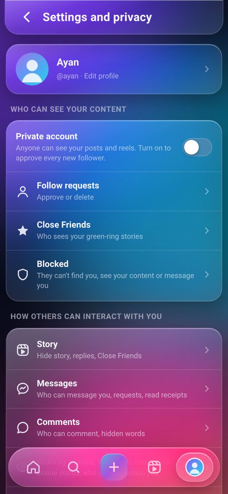
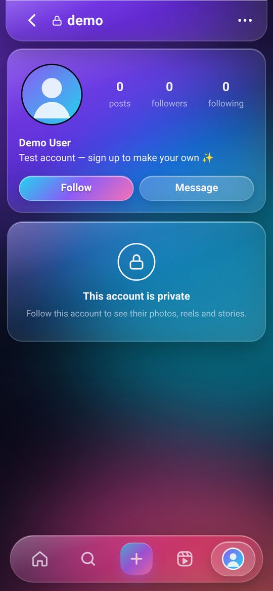
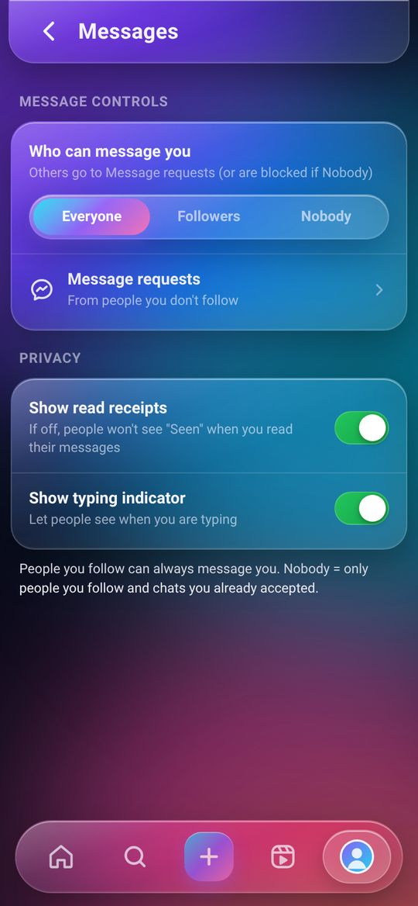
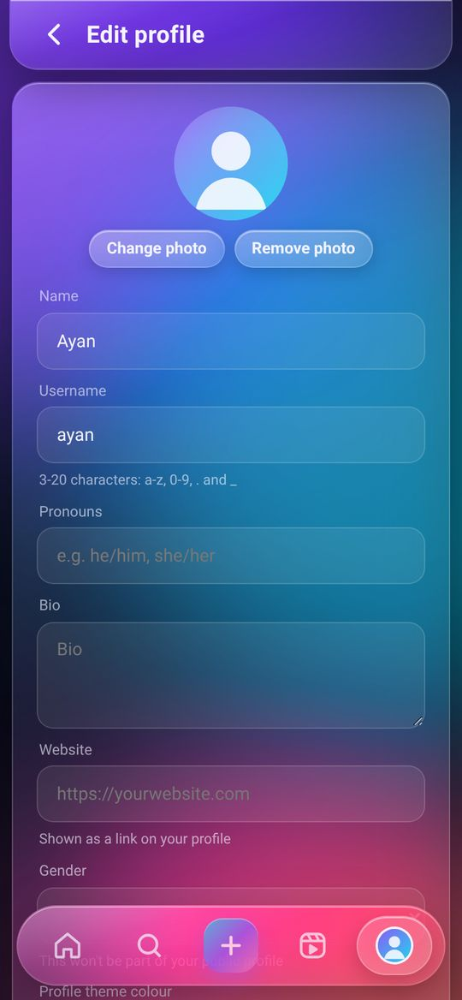
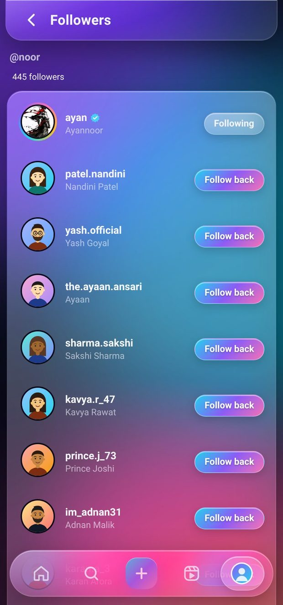
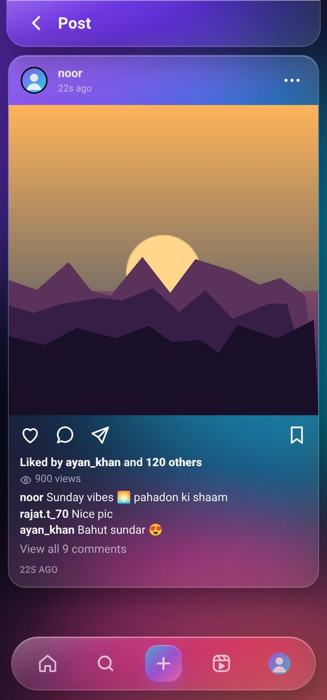
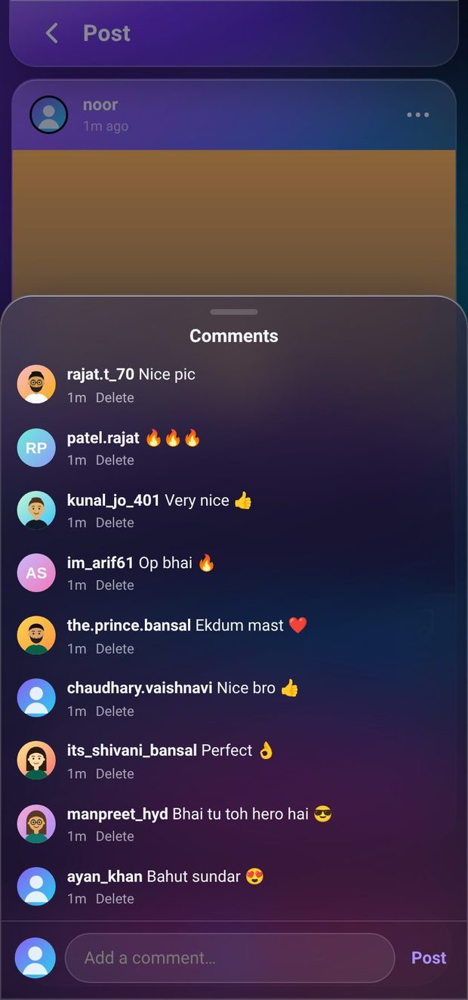
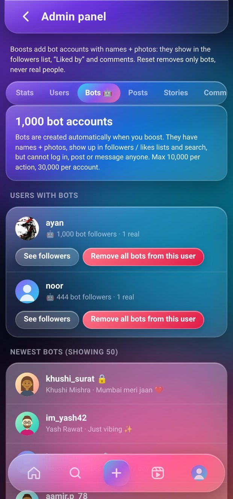

# Private Insta 🔒📸 — Instagram-style clone in Liquid Glass UI (v1.2)

**Live:** https://instaglass-live.sites.tab.bot  ·  test login: `demo` / `demo1234` (or sign up — it takes 5 seconds)
**Download v1.2:** [Android APK](https://github.com/nm621532-byte/instagram-clone-techbroz/releases/download/v1.2/InstaGlass-v1.2.apk) · [Web app ZIP](https://github.com/nm621532-byte/instagram-clone-techbroz/releases/download/v1.2/instaglass-web-v1.2.zip) · [All releases](https://github.com/nm621532-byte/instagram-clone-techbroz/releases)

> ⚠️ **Disclaimer:** Educational project by **Tech Bro Z**, not affiliated with Instagram/Meta. Name, logo and design are original.
> (The repo name stays `instagram-clone-techbroz`; the app was called InstaGlass in v1.0 and is **Private Insta** from v1.1.)

<p>
   
</p>

## 🆕 v1.2 — Bot boosts: followers list mein naam bhi dikhte hain (Hinglish)

<p>
   
</p>

v1.1 mein admin boost sirf number badhata tha — profile pe "125 followers" dikhta tha par list kholo to bas 1 asli follower. Ab **v1.2** mein:

- 🤖 **Bot accounts** — admin jitne followers badhaata hai, utne bot accounts (Indian naam + username jaise `aman.v_21`, `its_priya_sharma`, generated photo, chhota bio) us user ko **sach mein follow** karte hain. Followers list mein sabke naam, photo aur Follow button dikhte hain.
- ❤️ **Likes boost** — bot likes, to "**Liked by aman.v_21 and 120 others**" aur likes list mein sabke naam.
- 💬 **Comments boost** — bots chhote positive comments karte hain ("Mast hai 😍", "🔥🔥", "Nice bro 👍"…), har comment alag bot se, same comment lagaatar repeat nahi.
- 🔁 **Set boost / Reset** — kam karo ya 0 karo to sirf bots hat-te hain, **asli followers / likes / comments kabhi nahi**.
- 🛠️ Admin panel mein naya **Bots 🤖 tab** — kitne bots hain, kis user pe kitne bots, aur "**Remove all bots from this user**" button. Stats mein bots alag gine jaate hain.
- ⚡ Followers aur likes list ab **pages mein load** hoti hai (scroll karo, aur aate jaate hain) — 10,000+ followers pe bhi app smooth.
- 🔒 Bots login nahi kar sakte (koi password nahi), kisi ko message/notification nahi bhejte, aur private account ka content nahi dekh sakte. Search mein normal accounts jaise dikhte hain.
- Limits: ek baar mein max 10,000 followers/likes, ek account pe max 30,000 bot followers, ek post pe max 300 bot comments.

## v1.1 — Settings & Privacy (Hinglish)

Ab profile ke ⚙️ (gear) icon se **Settings and privacy** khulta hai — bilkul real Instagram jaisa, aur har setting **server pe enforce** hoti hai (sirf UI mein chhupaya nahi):

- ✏️ **Edit profile** — naam, username (unique check), bio, website link, pronouns, gender (private), photo change/remove, **profile theme colour**
- 🔒 **Private account** — non-followers ko posts, reels, stories, followers/following list nahi dikhte; follow dabane pe **Follow request** jaati hai (Confirm / Delete + notification). Purane followers bane rehte hain.
- 💚 **Close Friends** — green ring wali story sirf close friends ko; **Hide story from** — chune hue logon se story chhupao; **story replies**: Everyone / People you follow / Off
- 💌 **Messages** — kaun message kar sakta hai (Everyone / Followers / Nobody), anjaan logon ke message **Message requests** folder mein (Accept / Delete / Block), **read receipts** on/off, **typing indicator** on/off
- 💬 **Comments** — Everyone / Followers / Off, har post pe "Turn off commenting" aur "Hide like count", **Hidden words** (ye words wale comments sabse chhup jaate hain)
- ⛔ **Block** (na dhoondh sake, na dekh sake, na message, na follow) + Blocked list se Unblock · 🛡️ **Restrict** · 🔇 **Mute** posts / story
- 🟢 **Activity status** on/off · **@mentions** kaun kar sake
- 🔔 **Notifications** — likes, comments, follows, mentions, messages alag-alag on/off
- 🔐 **Security** — password change (purana password zaroori, baaki sab devices logout), **Login activity**, ek device ya sab devices se logout
- 🌗 **Theme** Auto / Dark / Light, language (Hindi jald), **Download your data** (sirf aapka data, ZIP), **Deactivate** (login karte hi wapas) aur **Delete account** (password se)
- 👑 Owner ke liye **hidden admin panel** (role server pe check hota hai; normal user ko 403): users list, blue ✔ badge, suspend/delete, koi bhi post/comment delete, stats, aur followers/likes/comments/views **boost** (v1.2 se followers/likes/comments bot accounts ke naam ke saath list mein dikhte hain; views sirf number)
- 🧹 Fake demo accounts hata diye: ab feed/stories mein sirf asli users ka content aata hai

### Chalana kaise hai (2 minute)
```bash
git clone https://github.com/nm621532-byte/instagram-clone-techbroz.git
cd instagram-clone-techbroz
node server.js          # Node 18+ chahiye, npm install ki zarurat nahi
# browser mein kholo: http://localhost:3000   (demo / demo1234)
```
Common errors:
- `EADDRINUSE` → port busy hai: `PORT=4000 node server.js`
- `node: command not found` → nodejs.org se Node 18+ install karo
- Data reset karna hai → `data/` folder delete karke dobara chalao

## 🇬🇧 English

A full, working Instagram-style social app with an original **liquid glass** design. Everything is real and persisted on the server — **zero npm packages**, only Node.js built-ins (`http`, `crypto`, `fs`).

### Features
- 🔐 Sign up / log in — passwords hashed with **scrypt**, server-side sessions (HttpOnly cookie), brute-force limits
- 🏠 Feed of people you follow + suggestions, infinite scroll · 📷 photo/video posts · ❤️ double-tap like · 💬 comments · 🔖 saves · 👁 view counts
- ✈️ Share a post to a friend's DMs, copy link, or the phone's share sheet
- ⭕ Stories (24 h, ring → grey when seen, Close Friends green ring, viewer list) · 🎬 Reels
- 💌 Real-time DMs (Server-Sent Events): text, photos, shared posts, typing, Seen, unsend, **message requests**
- 🔔 Notifications · 🔎 explore + search · 👤 profiles with website, pronouns and accent colour

### Bot boosts (v1.2)
Admin follower/like/comment boosts create **bot accounts** (flag `isBot`, no password, cannot log in, never message or notify anyone) that really follow / like / comment, so the followers list, the "Liked by" list and the comments show names and avatars. Bots are created lazily (the pool grows to the largest boost), have generated SVG avatars (`/bot-avatar/<id>.svg`, drawn faces or initials — no real photos), appear in search like normal accounts, and are listed separately in the admin **Bots** tab. Lowering or resetting a boost removes only bot entries. Existing v1.1 boost numbers are migrated into bot entries on first start (totals unchanged). Caps: 10,000 per action, 30,000 bot followers per account / bot likes per post, 300 bot comments per post. Followers/following/likes lists are paginated (`?offset=&limit=`).

### Settings & privacy (v1.1) — all enforced by the server
| Area | What you can do |
|---|---|
| Edit profile | name, unique username, bio, website, pronouns, gender (private), photo, profile accent colour |
| Account privacy | private account → follow requests (approve/delete), locked profile, posts/reels/stories/lists hidden from non-followers (API + media URLs return 403) |
| Story | hide story from people, Close Friends list (green ring), replies: everyone / people you follow / off |
| Messages | who can message you (everyone / followers / nobody), message requests folder, read receipts, typing indicator |
| Interactions | who can comment (everyone / followers / off), per-post comments off + hide like count, hidden words, restrict, block (+ blocked list), mute posts/stories |
| Activity | activity status on/off, who can @mention you |
| Notifications | likes, comments, follows, mentions, messages |
| Security | change password (needs the old one, logs out other sessions), login activity, log out one / other / all devices |
| Account | Auto/Dark/Light theme, language, download your data (ZIP of only your data), deactivate, delete (password) |
| About | version, disclaimer |

### Security (per-user rules, smoke test, no IDOR)
- Every API endpoint checks the session on the server; settings routes only ever change the **caller's** account (there is no URL with someone else's id).
- Private accounts, blocks, Close Friends and hidden stories are checked on every read **and** on the media file URLs.
- DMs are addressed as "me + other user"; DM photos are served only to the two people in that chat.
- Uploads are checked by their real bytes and size; text is rendered as text + strict CSP; CSRF guard (`X-IG` header); no password hash in any response or data export.
- `test/smoke.mjs` — **234 checks** (the 70 from v1.0 + privacy, follow requests, Close Friends, block, DM permissions, comments off, hidden words, password change, sessions, export, deactivate, "another user cannot change my settings", admin-only APIs, and v1.2 bot boosts: list fills with named bots, pagination, reset keeps real follows, bot likes/comments, bots cannot log in). Run it before every deploy:
```bash
node server.js &
node test/smoke.mjs http://localhost:3000
# optional admin checks: IG_ADMIN_USER=you IG_ADMIN_PASS=... node test/smoke.mjs http://localhost:3000
```

### Admin account (self-hosting)
The admin panel is hidden and every admin API checks the role on the server (others get 403), plus a password re-check that unlocks it for 30 minutes. To make an admin on your own server, pass a **password hash** (never the password) in `ADMIN_BOOTSTRAP`:
```bash
SALT=$(node -e "console.log(require('crypto').randomBytes(16).toString('hex'))")
HASH=$(node -e "console.log(require('crypto').scryptSync(process.argv[1], process.argv[2], 64).toString('hex'))" 'your-strong-password' $SALT)
ADMIN_BOOTSTRAP="{\"username\":\"admin\",\"salt\":\"$SALT\",\"pass\":\"$HASH\"}" node server.js
```

### Project structure
```
server.js        # HTTP server + REST API + realtime stream + settings/privacy rules (no dependencies)
seed.js          # creates one plain test login (demo / demo1234); upgrades remove the old v1.0 fake accounts
public/          # index.html, app.css (liquid glass), app.js (single-page app)
test/smoke.mjs   # smoke + security test (234 checks)
android/         # Capacitor shell for the APK
release/         # SHA-256 of each signed APK
.github/         # workflow that attaches the APK + ZIP to each release
```

### Download (Release v1.2)
- Android APK: https://github.com/nm621532-byte/instagram-clone-techbroz/releases/download/v1.2/InstaGlass-v1.2.apk (mirror: https://instaglass-live.sites.tab.bot/InstaGlass-v1.2.apk) — installs over v1.1 / v1.0 (same signature, versionCode 3)
- Web app ZIP: https://github.com/nm621532-byte/instagram-clone-techbroz/releases/download/v1.2/instaglass-web-v1.2.zip
- APK SHA-256: `bdaac43a4ba29688902156bbd4d780156672023cf72ebf99d4342a7c07359e5b`
- Older: [v1.1](https://github.com/nm621532-byte/instagram-clone-techbroz/releases/tag/v1.1) · [v1.0](https://github.com/nm621532-byte/instagram-clone-techbroz/releases/tag/v1.0)

---
Made by **Tech Bro Z** — YouTube [@techbrozdeveloper](https://www.youtube.com/@techbrozdeveloper) · Instagram [@tech_bro_z_1](https://www.instagram.com/tech_bro_z_1/)
Live: https://instaglass-live.sites.tab.bot · License: MIT
