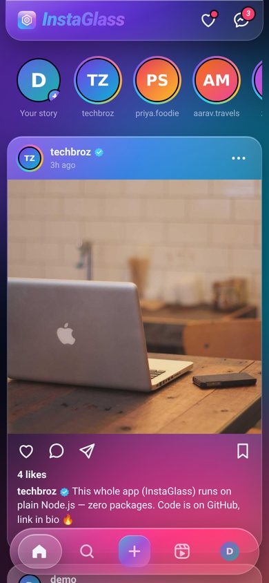
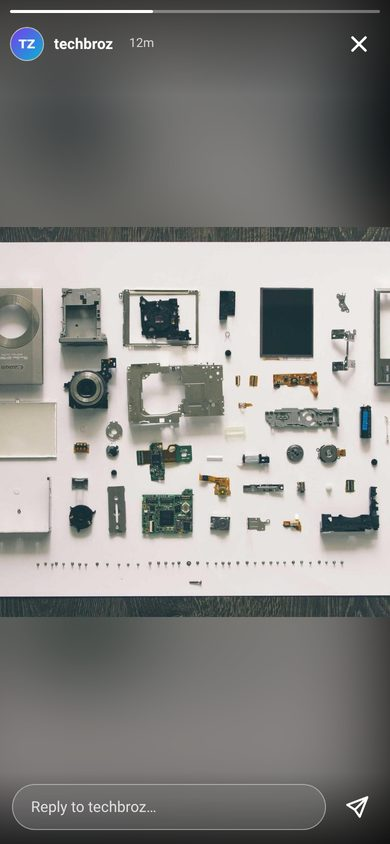
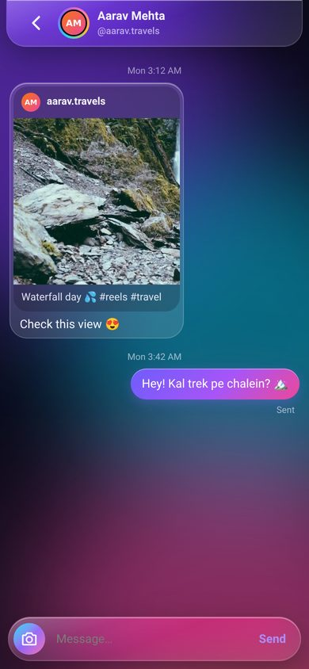
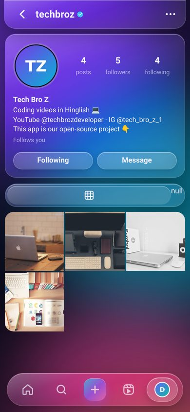

# InstaGlass 📸✨ — Instagram-style clone in Liquid Glass UI

**Live demo:** https://instaglass-live.sites.tab.bot  ·  demo login: `demo` / `demo1234`
**Download:** [Android APK](https://github.com/nm621532-byte/instagram-clone-techbroz/releases/tag/v1.0) · [Web app ZIP](https://github.com/nm621532-byte/instagram-clone-techbroz/releases/tag/v1.0)

> ⚠️ **Disclaimer:** Educational project by **Tech Bro Z** — not affiliated with, endorsed by, or connected to Instagram or Meta. Name, logo and design are original.

<p>
   
</p>

## 🇮🇳 Hinglish mein

Ye ek **poora working Instagram jaisa social app** hai — sab kuch real hai, server pe save hota hai, multi-user:
login/signup, photo/video post, **double-tap like ❤️**, comments, **share** (DM mein post bhejo ya link copy karo), save/bookmark,
**stories** (24 ghante baad gayab, ring + seen), **reels**, **real-time chat** (typing… dikhta hai, "Seen" bhi), notifications,
follow/unfollow, explore + search, profile edit — aur poora UI **Apple jaisa liquid glass** (frosted blur, glass tab bar, smooth animations).

Sabse mazedaar baat: **zero npm packages** — sirf Node.js ke built-in modules (`http`, `crypto`, `fs`). `npm install` ki zarurat hi nahi!

### Chalana kaise hai (2 minute)
```bash
git clone https://github.com/nm621532-byte/instagram-clone-techbroz.git
cd instagram-clone-techbroz
node server.js          # Node 18+ chahiye
# browser mein kholo: http://localhost:3000   (demo / demo1234)
```
Common errors:
- `EADDRINUSE` → port busy hai: `PORT=4000 node server.js`
- `node: command not found` → nodejs.org se Node 18+ install karo
- Data reset karna hai → `data/` folder delete karke dobara chalao

## 🇬🇧 English

A full, working Instagram-style social app with an original **liquid glass** design. Everything is real and persisted on the server.

### Features
- 🔐 Sign up / log in — passwords hashed with **scrypt**, server-side sessions (HttpOnly cookie), brute-force limits
- 🏠 Feed of people you follow + suggestions, infinite scroll
- 📷 Create posts (photo or video) with caption; edit/delete your own posts
- ❤️ Like (double-tap heart animation), 💬 comments (delete your own / on your post), 🔖 save to a private collection
- ✈️ Share: send a post to a friend's DMs, copy link, or the phone's share sheet
- ⭕ Stories: 24 h expiry, gradient ring → grey when seen, tap-through viewer with progress bars, hold to pause, reply by DM, "seen by" list for your own story
- 🎬 Reels: vertical snap-scroll video feed with like/comment/share
- 💌 Direct messages in **real time** (Server-Sent Events): text, photos, shared posts, typing indicator, Seen, unread badges, long-press to unsend
- 🔔 Notifications (likes, comments, follows), 🔎 explore grid + user search
- 👤 Profiles: avatar, bio, posts grid, followers/following lists, follow/unfollow, edit profile, delete account
- 🌗 Dark / light liquid-glass themes, Android APK

### Security (per-user rules, smoke test, no IDOR)
- Every API endpoint checks the session on the server; you can only edit/delete **your own** posts, comments, stories, messages and profile.
- DMs are addressed as "me + other user", so nobody can read someone else's chat by changing an id; DM photos are served only to the two people in that chat.
- Uploads are checked by their real bytes (JPG/PNG/WebP/MP4/WebM only) and size (8 MB images, 15 MB video); HTML is never injected (text is rendered as text) + strict CSP.
- CSRF guard (custom `X-IG` header), path-traversal guard, no password hash in any response.
- `test/smoke.mjs` — 70 checks: two users sign up, post, like, comment, story, DM both ways in real time, share a post via DM, and IDOR/auth attacks that **must fail**. Run it before every deploy:
```bash
node server.js &
node test/smoke.mjs http://localhost:3000
```

### Project structure
```
server.js        # HTTP server + REST API + realtime stream (no dependencies)
seed.js          # demo users/posts/stories so the app isn't empty
public/          # index.html, app.css (liquid glass), app.js (single-page app)
seed/            # demo images (Lorem Picsum / Unsplash, free to use)
test/smoke.mjs   # smoke + security test
android/         # Capacitor shell for the APK
.github/         # workflow that attaches the APK + ZIP to the release

```

### Download (Release v1.0)
- Android APK: https://github.com/nm621532-byte/instagram-clone-techbroz/releases/download/v1.0/InstaGlass-v1.0.apk  (mirror: https://instaglass-live.sites.tab.bot/InstaGlass-v1.0.apk)
- Web app ZIP: https://github.com/nm621532-byte/instagram-clone-techbroz/releases/download/v1.0/instaglass-web-v1.0.zip  (or the green Code → Download ZIP button)
- APK SHA-256: `7dd70973e7bf9ec1d6ba990135f3cbd00408e68b2cbeffb952507781c2f2d48f`

---
Made by **Tech Bro Z** — YouTube [@techbrozdeveloper](https://www.youtube.com/@techbrozdeveloper) · Instagram [@tech_bro_z_1](https://www.instagram.com/tech_bro_z_1/)
Live: https://instaglass-live.sites.tab.bot · License: MIT
